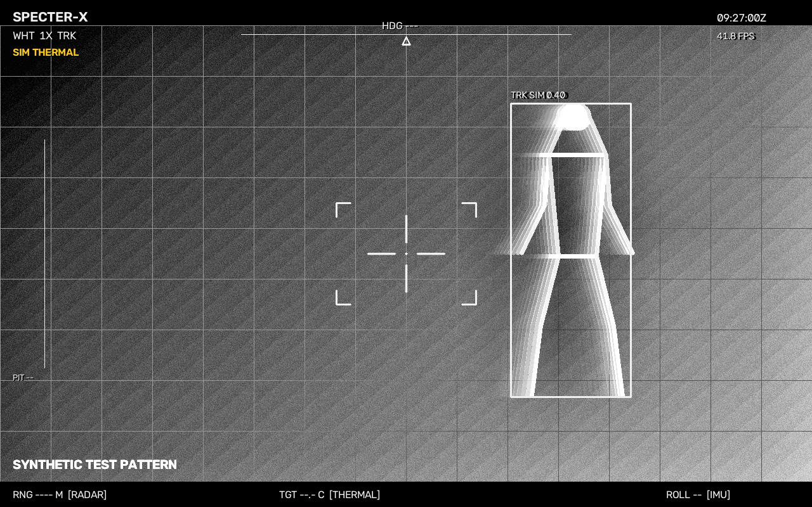
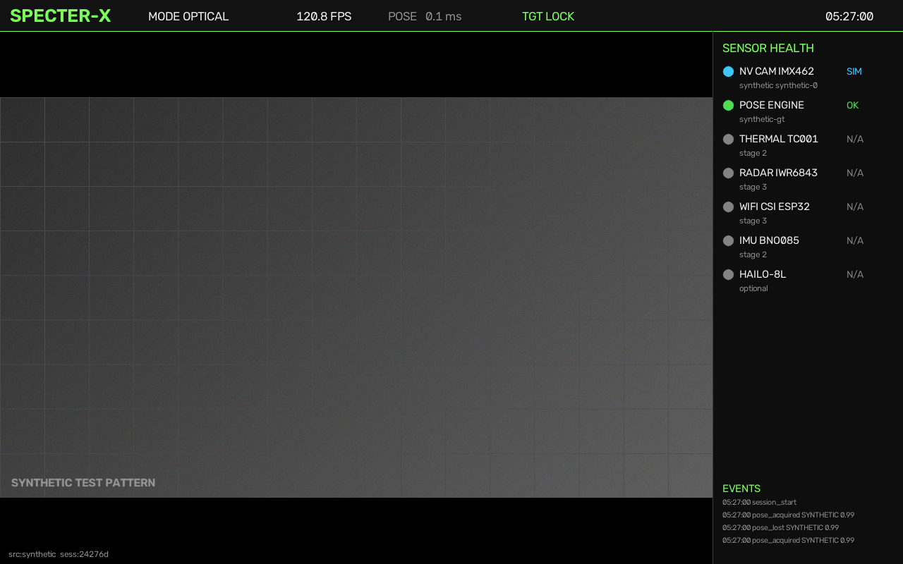

# SPECTER-X


**SPECTER-X is the first interface to a vertically integrated, multimodal
spatial-intelligence ecosystem.** A multispectral wearable and AR experience
built on a shared software and device foundation — SPECTER-OS — with a
persistent understanding of space — SPECTER-WORLD — and, further out, AIR,
GROUND and ORBIT nodes and experimental SPECTER-BIO physiology research.

The long-term "God's Eye" idea is a coherent, shared picture assembled from
complementary observations, with blind spots, uncertainty and evidence age
always visible. It does not mean universal visibility, identification through
walls, medical diagnosis, or certified rescue capability. The authoritative
statement of intent and engineering doctrine is the
**[North Star charter](docs/handbook/north-star.md)**.

**Persistent project memory (canonical startup reference for ChatGPT, OpenCode,
Work and other agents):** read the
[research ideas](docs/handbook/research-ideas.md),
[decisions](docs/handbook/decisions.md),
[experiment ledger](docs/handbook/experiment-ledger.md) and
[current agent handoff](docs/handbook/agent-handoff.md) after the charter.
A high-confidence sensor result is not new spatial information; missing
observations remain unknown.

The rule this repository is built around: **provenance first**. Every value on
screen is a `Measurement` carrying its sensor, host and sensor timestamps,
confidence/covariance, coordinate frame, and the algorithm and model that
produced it. Nothing reaches the display without a source. Synthetic data is
always labelled `SIM`/`SYNTHETIC`, never `OPTICAL`.


*POD mode: white-hot, 1x, hot-blob tracker locked (`TRK SIM 0.40`); radar/thermal/IMU show dashes until their sensors exist.*


*OPTICAL mode on the synthetic test pattern.*

---

## The ecosystem

| Name | Foundational ambition | Boundary |
|---|---|---|
| **SPECTER-X** | Multispectral wearable and AR interface: optical/NIR, thermal, radar, Wi-Fi CSI, LiDAR, positioning, skeletal perception | These are target modalities; not all are acquired, integrated or validated |
| **SPECTER-OS** | Unified software/device ecosystem: firmware, drivers, protocols, scheduling, health, calibration, logging, optimised communication | An ecosystem architecture — no standalone kernel or complete operating system is claimed |
| **SPECTER-WORLD** | Persistent 3D spatial intelligence: semantic maps, fusion, uncertainty, observation history, shared world models | A track list or a rendered scene is not this persistent model |
| **AIR / GROUND / ORBIT** | Future aerial and terrestrial nodes, satellite-data integration, resilient communications | ORBIT begins with existing data and services |
| **SPECTER-BIO** | Experimental non-contact physiology, radar vital signs, eventual quantum-sensing research | Laboratory research; no medical or remote life-detection capability established |

## Architecture

```
        ┌────────────── VIEW ──────────────┐   AR/HUD, provenance-tagged overlays
        │                                   │
   ┌────┴────┐   ┌──────── FUSION ────────┐ │   tracks, uncertainties, world model
   │  WORLD  │◄──┤  EKF / UWB / GNSS /     │◄┘   "absent evidence" vs "no evidence"
   │ 3D state │   │  team fusion, mapping  │
   └────▲────┘   └───────────▲────────────┘
        │                    │
   ┌────┴────────────────────┴─────┐
   │            LINK                │   signed UDP-multicast team link, HMAC,
   │  HEARTBEAT / POSE / TRACK /    │   clock discipline, stale rejection
   │  ALERT, encrypted only in v2   │
   └────────────────▲───────────────┘
        ┌───────────┴────────────┐
   ┌────┴─────┐            ┌─────┴─────┐
   │  SENSE   │            │   NODE    │  board support, capture, record queue,
   │ drivers  │            │ lifecycle │  transport, diagnostics, recovery
   └────┬─────┘            └───────────┘
        │
   ┌────┴───────────────────────────────────────────────┐
   │  optical · thermal · radar · Wi-Fi CSI · UWB ·    │  every sample carries
   │  GNSS · IMU · analog DAQ                           │  source, time, frame
   └────────────────────────────────────────────────────┘

   CORE  = shared contracts, provenance and configuration
   NODE  = one device: firmware, drivers, capture, recovery
   SENSE = one modality: driver, health, calibration
   LINK  = how units talk and how clocks are disciplined
   FUSION= how observations become tracks and a world state
   WORLD = what is believed, where, how uncertain, and since when
   VIEW  = what is shown, and what is visibly missing
```

## What is verified today, and what is not

This is the part worth reading carefully. A **passing acquisition preflight is
not a sensing result**, and the two are never merged in this repository.

### Verified on real hardware

| Achievement | Evidence | What it does **not** prove |
|---|---|---|
| **Alpha 002 — the ESP32-S3 CSI firmware was written to a real board and passes a 60-second acquisition preflight** | App-only write at `0x10000` with independent read-back verification; bootloader and partition table byte-identical before and after; boots; SoftAP `SPECTER-LAB` on channel 6 with its own DHCP at `192.168.4.1` | That it senses anything about a person |
| **CSI callbacks fire in SoftAP mode** | Callback counter rises with no station attached, and with a phone attached | That the CSI is calibrated for any sensing purpose |
| **Dense, gap-free acquisition from a controlled link** | 2364 frames in 60 s (39.0/s), longest inter-packet gap 79 ms device-side, **zero** gaps > 0.5 s | That acquisition is reliable *unattended* |
| **The IQ record is structurally sound** | Required null subcarriers zero in **2364/2364** frames; all 52 active subcarriers covered; `first_word_invalid=0`; 128 B / 64-slot LLTF | That the radio path is understood well enough for a physical model |
| **No loss inside the device** | 0 malformed lines, 0 sequence gaps, 0 queue drops; USB and console paths carry the same stream within 0.25% | That a slow host cannot still wedge the link |
| **The offered load is received** | 600 ping frames against 596 expected over 59.6 s — ≤ 0.7% loss | That a different station behaves the same way |
| **Alpha 001 — the DATAQ DI-188 is a first-class sensor** | 1,801 s four-channel soak: 901,080 groups, 0 malformed, 0 serial errors; the DAQ produces provenance-tagged `Measurement`s that reach the HUD and the JSONL log | That any analog channel is calibrated — all four inputs were floating |
| **A measurement tool that is honest under failure** | The preflight tool's own scoring defect was found, fixed and regression-tested against real captured frames; 287 tests pass, 1 skipped | That a passing score means the phenomenon was detected |

### Not verified — and not claimed anywhere in this repository

- **Motion detection.** Nothing has been measured. The first real movement
  experiment found no verified detection; that result stands.
- **Vital signs, respiration, cardiac sensing.** No human-subject run, no
  reference instrument, no sensitivity figure. These are later research gates.
- **Sustained unattended reliability.** The one passing run is 60 seconds long
  and required an awake station. A phone that is idle drops the link to
  ~0.3 frames/s — demonstrably a station-side effect, since the device's own
  counters show no loss in any run.
- **Performance superiority.** No comparison against any alternative exists, so
  "better" is unsupported in either direction.
- **A uniform 35 Hz feed.** The passing capture is gap-free but bimodal
  (median 26.9 ms, p95 61.8 ms); a 35 FPS HUD cannot be assumed from it.
- **Calibrated analog sensing.** The DI-188 inputs were floating throughout.
- **Through-wall presence, rescue, medical or life-safety claims.** Research
  directions with task-, material- and geometry-specific published results —
  not SPECTER-X capabilities.

The detailed ledger, with every threshold and every caveat, is the
**[verification baseline](docs/handbook/verification-baseline.md)**.

---

## Repository layout

```
firmware/esp32-csi/          ESP-IDF CSI streamer (station and SoftAP roles)
specter/
  app.py                     Entry point: python -m specter.app
  hw/pinmap.yaml             Click Shield pin/bus map, validated at startup
  sensors/
    base.py                  Health enum + SensorStatus (feeds the HUD panel)
    stubs.py                 Presence probes for not-yet-integrated sensors
    nightvision/camera.py    Picamera2 -> OpenCV -> synthetic camera sources
    thermal/tc001.py         TC001 frame split + raw->degC helper
    thermal/senxor.py        SenXor 160x120 driver, UNVERIFIED
    thermal/interface.py     Shared thermal driver interface
    radar/tlv.py             IWR6843 TLV header/point parser
    imu/                     lsm9ds1.py (raw + Mahony) + bno085.py behind ImuLayer
    gnss/neom9n.py           UBX-NAV-PVT parser + NMEA fallback + synthetic
    uwb/dw1000.py            DS-TWR ranging + two-unit simulator
    experimental/            event/acoustic/vitals/VLM/LoRa/gas stubs + sims
    esp32/                   CSI dispatcher, parser, analysis, supervisor,
                             synthetic link and diagnostics
    di188/                   DATAQ DI-188 USB DAQ: protocol driver, calibration,
                             stats, CSV recorder, stability harness, dashboard
  calibration/di188.json     DI-188 counts->volts calibration (optional)
  localization/ekf.py        Per-unit EKF (IMU predict, GNSS anchor, UWB ranges)
  net/                       Signed UDP-multicast team link (heartbeat/pose/track/alert)
  sim/team.py                CI demo: python -m specter.sim.team --units 2
  fusion/
    measurement.py           Measurement + Provenance dataclasses, JSON round-trip
    coordinate_frames.py     Transform (R,t), FrameGraph, PinholeCamera projection
    tracking.py              Track/Tracker interface
    team.py                  Mahalanobis + Hungarian team fusion, man-down
  ml/pose/estimator.py       YOLO11n-pose / synthetic-GT / none backends
  events/log.py              JSONL session log and acquired/lost hysteresis
  hud/renderer.py            OpenCV 1280x800 HUD
  hud/csi_views.py           CSI waterfall, spectrum and reference views
  hud/team_overlay.py        Teammates, peer tracks, mini-map, pose badge
events/sessions/             One <session>.jsonl per run
tools/di188.py               DI-188 CLI: probe | monitor | dashboard | record |
                             stability | calibrate
tools/esp32_lab_preflight.py Hardware preflight and scoring for the CSI link
tests/                       pytest suite (projection, serialisation, smoke run, team)
docs/                        Handbook, checkpoints and evidence records
```

## Hardware

| Role | Part | Link | Stage |
|---|---|---|---|
| Compute | Raspberry Pi 5, 8 GB | — | 1 |
| Low-light camera | Arducam IMX462 (CSI, libcamera / Picamera2) | CSI-2 | 1 |
| Display | 7" 1280x800 touchscreen | DSI/HDMI | 1 |
| Thermal | TOPDON TC001 (256x192; UVC frames are 256x384, thermal words in lower half) | USB UVC | 2 |
| IMU | BNO085 (kept); 9DOF Click LSM9DS1 on the Click Shield (preferred) | I2C (`i2c-1`) | 2 / 4b |
| Radar | TI IWR6843AOPEVM (TLV point clouds) | UART-over-USB | 3 |
| RF sensing | ESP32-S3 Wi-Fi CSI | USB serial | 3 |
| Click carrier | MIKROE Pi 5 Click Shield (MIKROE-6423): 2x mikroBUS + Shuttle | Pi 5 header | 4b |
| UWB ranging | UWB Click (MIKROE-4199, Qorvo DW1000), mikroBUS socket 1 | SPI `spi0.0` | 4b |
| GNSS | GNSS 7 Click (MIKROE-3922, u-blox NEO-M9N, UBX+NMEA) socket 2 | UART `/dev/serial0` @38400 / PPS `GPIO18` | 4b |
| Thermal (candidate) | Meridian SenXor 160x120 EVK — driver UNVERIFIED until hardware arrives | USB (`pysenxor-lite`) | 4b |
| Analog DAQ | DATAQ DI-188 — 4-ch ±10 V differential, 12-bit, open-source firmware | USB CDC-ACM (`/dev/cu.usbmodem*`) | 5 (Alpha 001) |
| Accelerator | Hailo-8L (optional) | PCIe (M.2 HAT) | 5 |

Pin/bus assignments live in `specter/hw/pinmap.yaml` (socket 1 = UWB, socket 2 =
GNSS, IMU on `i2c-1`) and are validated at startup — wiring mistakes fail fast,
not silently.

### EXPERIMENTAL candidates (stub drivers + simulators only, Stage 6+)

| Role | Part | Status |
|---|---|---|
| Event camera | Prophesee GenX320 Starter Kit for Pi 5 (MIPI, OpenEB) — motion trigger | stub + sim |
| Acoustic camera | miniDSP UMA-16 v2 16-mic USB array (Acoular) — voice/alarm direction | stub + sim |
| Vitals radar | IWR6843 breathing/heart-rate mode for still, trapped people | stub + sim |
| On-device VLM | Raspberry Pi AI HAT+ 2 (Hailo-10H) — spoken track summaries, always AI-SUMMARY labelled | template + sim |
| Mesh fallback | LoRa (Meshtastic-compatible) — heartbeats and man-down when Wi-Fi drops | codec + sim |
| Gas | CO/CO2 environmental danger overlay (advisory only) | stub + sim |

## Quick start (Mac / Linux desktop)

```bash
python3 -m venv .venv && source .venv/bin/activate
pip install -r requirements.txt          # numpy, opencv-python, pytest
pip install ultralytics                  # optional: real pose (downloads yolo11n-pose.pt on first run)

python -m specter.app --source synthetic --windowed     # test pattern, no camera needed
python -m specter.app --windowed                        # webcam via OpenCV (auto fallback)
python -m specter.app --source synthetic --frames 30 --headless   # CI smoke run
python -m specter.sim.team --units 2                         # CI team demo (SIM)
pytest -q
```

Optional desktop extras (graceful fallback when missing — CI does not need them):

```bash
pip install pyubx2 pyyaml     # UBX helpers / pinmap YAML (internal parsers otherwise)
```

Keys: `q`/`Esc` quit, `m` cycle mode (`OPTICAL` / `NIGHT-GREEN` / `POD`),
`p` POD polarity (white-hot / black-hot), `z` POD zoom (1x / 2x / 4x / 8x),
`t` toggle the hot-blob tracker.

Useful flags: `--source auto|picamera|opencv|synthetic`, `--pose auto|yolo|synthetic|none`,
`--model yolo11n-pose.pt`, `--conf 0.4`, `--frames N`, `--headless`, `--windowed`,
`--save-frame hud.png`, `--log-dir DIR`.

`--pose auto` uses YOLO11n-pose if Ultralytics is installed; otherwise it uses
ground-truth keypoints when the source is synthetic, and no pose for a real camera.

## DI-188 USB DAQ (stage 5, macOS bench tool)

A DATAQ DI-188 — 4 differential ±10 V channels, 12-bit — is attached over USB
CDC-ACM. It needs **no driver and no kext**; it appears as
`/dev/cu.usbmodemXXXX`. The driver speaks the published DI-188 ASCII protocol
and never flashes firmware.

```bash
python3 tools/di188.py probe         # identity + the instrument's own calibration
python3 tools/di188.py monitor       # live statistics in the terminal
python3 tools/di188.py dashboard     # real-time dashboard at http://127.0.0.1:8765/
python3 tools/di188.py record        # CSV with a provenance header
python3 tools/di188.py stability     # 30-minute link stability report
python3 tools/di188.py calibrate     # two-point calibration vs a known reference
```

### Alpha 001 — the DAQ inside SPECTER-X

The DAQ is now a first-class sensor: it produces provenance-tagged
`Measurement`s that reach the HUD and the JSONL session log.

```bash
python -m specter.app --source synthetic --daq di188 --mode ANALOG \
    --frames 400 --min-seconds 12 --headless --save-frame docs/alpha001/app.png
```

`--mode ANALOG` shows the four channels with their state. A channel with
nothing plugged in is badged **FLOATING / NOISE**, carries no volt value and
is never counted as a measurement — while the health row still reports the
instrument as `OK`, because the instrument is fine and the input is not.
Measurements are logged at ~1 Hz, not per ADC sample.

Evidence: [`docs/checkpoints/002-alpha001-daq-end-to-end.md`](docs/checkpoints/002-alpha001-daq-end-to-end.md).
Wiring, terminal map and the safe first-measurement procedure:
[`docs/di188-wiring.md`](docs/di188-wiring.md). Progress log:
[`docs/checkpoints/001-hardware-di188.md`](docs/checkpoints/001-hardware-di188.md).

## Team data flow (Stage 4b)

```
sensors -> Measurements -> local tracks -> network -> team fusion -> HUD
   |            |               |              |            |           |
 TC001/      SRC + conf      Kalman in     signed UDP    Mahalanobis teammates,
 SenXor      + frame         body frame    multicast:    + Hungarian  peer tracks
 IMX462      SIM if          + ENU pose    Heartbeat     merged list  SRC:UNIT/
 DW1000      synthetic       (EKF: IMU/    PoseStamped   cites every  SENSOR,
 NEO-M9N                     GNSS/UWB)     TrackReport   Measurement  mini-map,
 LSM9DS1                                   Alert         id           POSE badge
```

Compact tracks travel between units — video never does. Provenance (source
unit, sensor, Measurement ids) survives the hop, so the HUD still prints
`SRC: <UNIT>/<SENSOR> conf 0.xx` for peer detections.

The Python subsystems live inside the `specter` package (rather than at the repo
root) so `python -m specter.app` and imports work without path hacks.

## Raspberry Pi 5 setup

1. **OS:** flash Raspberry Pi OS Bookworm 64-bit (desktop, for the HUD window), then
   ```bash
   sudo apt update && sudo apt full-upgrade -y
   sudo apt install -y python3-picamera2 python3-opencv python3-venv git
   ```
2. **Camera overlay:** edit `/boot/firmware/config.txt`:
   ```ini
   camera_auto_detect=0
   dtoverlay=imx462
   ```
   (If the Arducam module is on the CAM0 port, Arducam's docs use `dtoverlay=imx462,cam0`.)
   Reboot, then check: `rpicam-hello --list-cameras` and `rpicam-hello -t 5000`.
   Some Arducam IMX462 boards need Arducam's own libcamera tuning file; follow
   Arducam's IMX462 page if the camera is not listed.
3. **venv that can see apt's picamera2/libcamera:**
   ```bash
   git clone <repo> specter-x && cd specter-x
   python3 -m venv --system-site-packages .venv && source .venv/bin/activate
   pip install -r requirements-pi.txt   # numpy, pytest, ultralytics (optional, pulls CPU torch)
   ```
   Do **not** `pip install opencv-python` inside this venv; use apt's `python3-opencv`
   so it matches the system Qt/GTK for the fullscreen window.
4. **Run:** `python -m specter.app` (fullscreen 1280x800; picks Picamera2 automatically).
   Over SSH without a display: `python -m specter.app --headless --frames 300`.
5. **Pose performance on the Pi 5 CPU:** YOLO11n-pose at `imgsz=640` is the slowest
   part of the loop. If it is too slow, export to NCNN (`yolo export model=yolo11n-pose.pt format=ncnn`)
   and pass `--model yolo11n-pose_ncnn_model`; the Hailo-8L path is Stage 5.

## Event log format

`events/sessions/<YYYYmmdd-HHMMSS-xxxxxx>.jsonl`, one JSON object per line:

```json
{"t_host": 1760253038.1, "session": "20261012-073038-2bdf03", "seq": 2,
 "event": "pose_acquired", "detail": {"frame_index": 3},
 "measurement": {"sensor": "nightvision", "kind": "pose2d", "t_host": ..., "t_sensor": ...,
   "frame_id": "imx462-0/image", "value": {"keypoints_xy": [...], "keypoint_conf": [...],
   "bbox_xyxy": [...], "image_size": [1920, 1080]}, "confidence": 0.87, "covariance": null,
   "provenance": {"sensor_id": "imx462-0", "source": "nightvision", "algorithm": "yolo11n-pose",
     "model_version": "yolo11n-pose.pt@ultralytics-8.x", "frame_index": 1234, "parents": []}}}
```

Events in Stage 1: `session_start`, `pose_acquired` (3 consecutive frames with a person),
`pose_lost` (5 consecutive frames without, or `reason: session_end`), `mode_change`,
`sensor_offline`, `sensor_recovered`, `session_end`.

## Coordinate conventions

* `T_a_b` maps points in frame `b` to frame `a`: `p_a = R p_b + t`; compose `T_a_c = T_a_b @ T_b_c`.
* Camera frames: OpenCV optical (+x right, +y down, +z forward).
* Body frame: +x forward, +y left, +z up. `R_CAM_BODY` converts body -> camera optical.
* `specter/calibration/rig.json` holds **placeholder** intrinsics (from a nominal FOV) until calibrated.

## Roadmap

1. **Stage 1: optical HUD.** IMX462 via Picamera2 and OpenCV/synthetic fallbacks,
   YOLO11n-pose, fullscreen HUD with sensor health, provenance-tagged overlays, JSONL event log, tests.
2. **Stage 2: thermal + IMU + calibration.** TC001 UVC driver (raw mode, °C per pixel),
   BNO085 orientation, IMX462 intrinsics, optical/thermal extrinsics with a heated checkerboard,
   thermal overlay with its own `SRC: THERMAL` tags, horizon line from the IMU.
3. **Stage 3: radar + Wi-Fi CSI.** IWR6843AOP config and TLV point clouds projected into the
   camera view; ESP32-S3 CSI firmware and host parser; hardware timestamp alignment across sensors.
   *Acquisition is done and measured — see the Alpha 002 results above; sensing is not.*
4. **Stage 4: fusion and tracking.** Kalman tracks in the body frame fed by optical/thermal
   bearings, radar range/Doppler and CSI features; each track lists the sensors and Measurement
   ids behind it; IMU-stabilised track display; session replay from the JSONL log.
4b. **Stage 4b: team networking.** Pi 5 Click Shield carrier; DW1000 UWB
   two-way ranging outdoors and indoors with the EKF in a shared ENU frame; signed
   UDP-multicast team link (Heartbeat/PoseStamped/TrackReport/Alert, HMAC team key,
   chrony/PTP discipline, stale rejection); Mahalanobis+Hungarian team fusion with provenance
   intact; man-down alerts; HUD teammate markers, peer contacts, mini-map and pose badge.
   Demo: `python -m specter.sim.team --units 2`.
5. **Stage 5: acceleration and field unit.** Hailo-8L pose/detection (HEF models), power and
   thermal budget, battery and enclosure, touchscreen controls, packaged systemd service.
6. **Stage 6: wearable (helmet + chest + headset, then goggles).** Helmet sensor head
   (thermal/event/acoustic), chest compute (Pi 5 + AI HAT+ 2 for on-device VLM summaries,
   always `AI-SUMMARY` labelled with cited Measurement ids), headset display; LoRa mesh
   fallback for heartbeats and man-down. Long-term form: goggles. EXPERIMENTAL modules
   graduate here only after bench validation.

## Honest limits

- LWIR thermal sees surface temperature, not through things: it does **not** see
  through walls, glass, or much beyond thin fabric. Anyone claiming otherwise is
  selling something.
- Radar and Wi-Fi CSI sensing through interior walls is real *published research*
  under specific materials, geometry and protocols. No SPECTER-X implementation
  has demonstrated it, so this repository does not claim it. The CSI work here is
  an acquisition path that has not yet been used to detect anything.
- Synthetic mode is a test pattern for development and CI. It proves the pipeline
  runs, not that any sensor works.
- The DI-188 panel shows **floating-input noise**: the instrument streams for
  real, but nothing is plugged into the four analog inputs and no reference
  source has been applied. Those traces are ADC noise, not measurements, and the
  HUD says so on every channel.
- A passing CSI acquisition preflight is not a detection. The first real motion
  experiment found nothing, and a better acquisition rate does not by itself
  change that.
- UWB ranging needs line-of-sight for its ~10 cm accuracy; NLOS measurements are
  flagged and de-weighted, not hidden.
- GNSS fails indoors — the HUD says `POSE: REL` there and shows growing
  uncertainty instead of a confident dot.
- The SenXor thermal path is UNVERIFIED until the EVK is checked against a
  reference target.
- Gas readings are advisory only. This prototype is **not certified safety gear**
  and must not be treated as such on a fireground.

### Team link security limits (read before the field)

- **No confidentiality.** The team key authenticates messages (HMAC-SHA256) but nothing
  is encrypted: anyone listening on the Wi-Fi sees unit positions, tracks and alerts
  in cleartext. Do not carry sensitive information beyond the tactical picture.
- **One shared key means mutual impersonation.** Every unit holds the same team key, so
  any compromised or rogue unit holding it can sign messages as *any* `unit_id`. HMAC
  keeps outsiders out; it does not keep insiders honest. Mitigation is procedural for
  now: guard the key, rotate it when membership changes.
- **Replay is gated, not gone.** The receive path drops replays and old sequence numbers
  (ordered boot ids + strictly increasing seq per sender), but the replay table is
  in-memory: a *receiving* unit that reboots forgets it, briefly reopening the window.
  Roadmap: persist the peer table, then per-message encryption (AES-GCM or
  ChaCha20-Poly1305 via the optional `cryptography` package) — listed as work, not done.

## The handbook

The canonical documentation lives in [`docs/`](docs/README.md). It is the
authoritative record of intent, architecture, evidence and the work in progress.

| Read this | For |
|---|---|
| **[North Star charter](docs/handbook/north-star.md)** | Identity, ambition and engineering doctrine — the authoritative North Star |
| **[Verification baseline](docs/handbook/verification-baseline.md)** | What has actually been measured, with every threshold and caveat |
| **[Architecture](docs/handbook/architecture.md)** | CORE / NODE / SENSE / LINK / FUSION / WORLD / VIEW and the data flow |
| **[Data contracts](docs/handbook/data-contracts.md)** | Provenance, clocks, calibration and uncertainty |
| **[Firmware strategy](docs/handbook/firmware-strategy.md)** | First-party ESP-IDF approach, component boundaries and migration gates |
| **[Interfaces](docs/handbook/interfaces.md)** | What each component must implement |
| **[Roadmap](docs/handbook/roadmap.md)** and **[backlog](docs/handbook/backlog.md)** | Gated horizons and prioritised work orders |
| **[Validation](docs/handbook/validation.md)** | Experiments, benchmarks, simulation and replay |
| **[Research program](docs/handbook/research-program.md)** | How each modality helps, and where it fails |
| **[Constraints](docs/handbook/constraints.md)** | Batteries, enclosures, safety and privacy |
| **[Hardware inventory](docs/handbook/hardware-inventory.md)** | What is actually held, and how far each item has been verified |
| **[Sources](docs/handbook/sources.md)** | Which source supports which statement |
| **[Alpha reconciliation](docs/handbook/alpha-95eae17-review.md)** | The dated `95eae17` engineering review |

Checkpoints and evidence records are indexed in
[`docs/checkpoints/`](docs/checkpoints/001-hardware-di188.md).

## Sponsors & support

No sponsorship has been confirmed in the sources reviewed for this repository.
A prospective sponsor register of unverified leads — with no commitments,
receipts or contact made — is kept in the handbook's
[supplier register](docs/handbook/suppliers.md). Sponsorship does not change a
device's calibration or evidentiary status.

## License

MIT — see [LICENSE](LICENSE).
