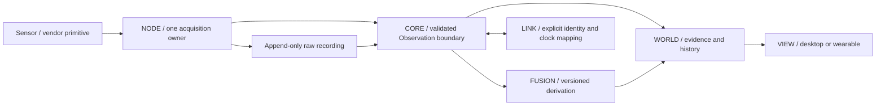

# SPECTER-X engineering contract

**Adopted for this audit branch, 23 October 2026.** Implements the owner's
[canonical charter](../handbook/north-star.md); it does not change project identity
or frozen experimental gates. Applies equally to OpenCode, Codex and human work.
Architecture constraints reduce avoidable rework; no model is exempt from evidence.
[Work-order template](WORK_ORDER.md) · [Next scoped task](NEXT_WORK_ORDER.md) · [audit](../audit/README.md) · [documentation hub](../README.md).

## Intended system and current boundary

SPECTER-X is the wearable interface to SPECTER-OS and persistent SPECTER-WORLD,
with future AIR, GROUND, ORBIT and BIO research. The current desktop is an offline
research instrument: evidence indexing, replay, diagnostics and inspection. It is
not yet persistent spatial mapping, a live acquisition supervisor, a fleet controller
or a physiology detector. Build toward those boundaries incrementally.

The diagram is the target data flow. In this branch the replay route is implemented;
physical NODE supervision, calibrated spatial fusion and authenticated distributed
WORLD synchronization need separate approved work orders. Legacy `Measurement`
objects and the new `Observation` contract coexist. Adapt explicitly; do not maintain
a third envelope or silently reinterpret a legacy confidence as probability.

## Ownership and dependency rules

| Boundary | Owns | Must not own |
|---|---|---|
| NODE / SENSE | Exclusive device handle, vendor byte layout, metadata, native timestamps, raw capture, bounded framing and reconnect state | Human detection claims, UI state, silent synthetic fallback presented as hardware |
| CORE / platform | Observation validation, registry, source/epoch ordering, loss accounting, lifecycle and bounded queues | Device reads from a renderer; rewriting original timestamps |
| LINK | Versioned serialization, per-device authentication, replay and expiry handling, explicit delivery semantics | Treating a group HMAC as individual identity, encryption or clock synchronization |
| FUSION | Calibrated transformations, explicit assumptions, model versions and parent evidence | Inventing calibration/covariance, double counting parents, assuming independent errors |
| WORLD | Queryable history, semantic entities, provenance edges, revisioned state and bounded projections | Opening devices, inferring experiment outcomes from healthy capture, autonomous safety decisions |
| VIEW | Controls, responsive layout, readable epistemic labels, evidence inspection | Estimation, hardware I/O, generated confidence, hidden remote/model downloads |

`tools/check_architecture.py` enforces a **limited static** WORLD import boundary
transitively through in-repository Python modules, rejects dynamic import calls in
that closure, and checks required entry documents. It is not a security sandbox or
complete proof of the rules in this document. The offline suite executes this gate.
Intentional exceptions require a reviewed ADR and an updated negative control.
Do not evade it with wrappers, string imports or subprocesses.

## Interface control: evidence at every seam

Use `specter/platform/observation.py` and its shipped schema as the executable
Observation v1 contract. An adapter must preserve:

- Globally scoped source/node identity, kind, units, sequence and clock epoch.
- Acquisition ticks, domain, tick frequency and wrap semantics. A clock contract
  cannot change inside an epoch; reconnect/reset creates an explicit new epoch.
- Receive time independently from acquisition time. Missing receive time remains
  unknown; playback time never establishes physical freshness.
- Origin and classification independently: hardware/simulated/unknown origin;
  measured/inferred/predicted/simulated/unknown interpretation as supported by schema.
- Raw artifact hash/line or equivalent immutable reference, algorithm revision,
  parent references, calibration state and uncertainty representation.
- Finite numbers, valid dimensions/units and positive semidefinite covariance.
  No negative variances, NaN/Infinity in serialized contracts, or made-up identity
  covariance to make an unimplemented method appear usable.

Reject invalid envelopes before changing sequence, registry or replay-guard state.
A rejected envelope gets a reason/count; it must not poison the next valid record.
For legacy display-only values, nonfinite payloads serialize as explicit nulls;
that compatibility conversion is not scientific data acceptance. Error/unknown
states must survive rendering. Spatial image variation is not sensor uncertainty.

CSI adapters must document signed byte order, IQ ordering, subcarrier layout,
invalid slots, frame populations (`sig_len`), PHY rate, RSSI and available gain
metadata against the exact firmware and ESP-IDF version. An amplitude plot does
not validate phase coherence. Differential-phase research requires suitable
simultaneous channels, phase-reference/offset characterization and frozen controls.
Never fabricate missing gain or antenna information.

## Lifecycle and resource contracts

One owner per physical device. A renderer only requests operations from that owner;
no second serial reader competes with a recorder. Blocking reads require timeouts,
cancellation, bounded queues and diagnostic accounting. Reconnect is a visible
state transition, not an invisible epoch continuation. Host durations use monotonic
time; wall-clock timestamps are for external correlation and require mapping.

WORLD indexes read-only source files into a disposable database. Preserve generation
guards across asynchronous requests: a delayed READY response from source A must
never reappear after selecting B. Disable controls while loading; retain the
regression and its mutation check. Do not classify unapproved files as hardware
because their names resemble a capture. A file hash proves bytes, not labels.

Current bounds: 512 MiB source guard, default 250,000 indexed records (maximum
1,000,000), 80 queried rows, 160 signal-history records, 256 registry history entries,
12 concurrent HTTP requests and 4 KiB request bodies. SQLite overhead can exceed its
index-file threshold; these are guardrails, not hard process-memory guarantees.
Catalog enumeration streams at most 20,000 entries and sorts only the bounded
result; incomplete scans and scan errors stay visible. No full-recording array
should be created in a frontend polling path.

## WORLD desktop design

Prioritize a useful research workbench over fictional capability displays. Keep
source/mode, selected record and replay controls persistent. Show the signal alongside
packet history, radio metadata, data quality and provenance. Every selectable plot
must open the corresponding evidence. Color scales state whether they are relative;
packet-order spacing must not masquerade as uniform acquisition time or spatial axes.

Unavailable hardware gets an empty state and integration requirements. Receipt is
unknown until the owner provides a dated inventory source. No animated placeholder
tracks, map points, heartbeats, confidence, node uptime or live labels. Spatial views
activate only after frame/time/calibration validation. Provide keyboard operation,
visible focus, readable contrast, bounded tables and responsive screenshots at
900/1280/1512/1920 widths. Do not replace failed controls with snapshots alone.

## OS, firmware and Ferret

SPECTER-OS denotes the unified runtime/device ecosystem; it does not require a new
kernel. Keep runtime, device adapter, transport, protocol, storage and UI interfaces
portable. Start on supported Linux/macOS development paths with repeatable offline
replay. Use ESP-IDF/vendor primitives for the ESP32 until profiling and controlled
benchmarks justify replacement. Own the application protocol, scheduling/health,
calibration, diagnostics and reproducible build configuration first.

Ferret is an optional future Linux-compatible target. The local README inspected
at `6a2eddeb5595` describes early source-level Rust replacement work and explicitly
leaves physical hardware boot/runtime performance untested. No kernel build or
physical compatibility was verified in this audit. Keep SPECTER functional without
Ferret; add a future QEMU/Linux-ABI smoke gate and then physical target validation
before claiming support. Do not couple CSI inference to a custom-kernel milestone.

## Validation and agent execution

Before coding, record base/head, branch owner, dirty paths, precise acceptance criteria,
interfaces and a short work order. Read the current handbook rather than older chat
claims. For a bug: reproduce the failure, add the smallest adversarial regression,
fix the boundary, run focused checks, then the relevant suite. A positive synthetic
injection must be detected and a null must remain negative. Test a deliberate
mutation so a broken implementation cannot pass by doing nothing.

Trials/sessions/participants, not correlated packets, are the inferential units when
appropriate. Freeze labels/randomization, feature selection, split, permutation
unit, effect-size definition, bootstrap unit, confound tolerances and stopping rules
before collection. Split independent repetitions/sessions; never tune on held-out
labels. Report exclusions, protocol deviations, power and uncertainty. A failed
endpoint is not evidence that motion is absent. A post-hoc amplitude change is not
confirmation. Preserve failed and superseded results; only a new authorized protocol
can advance the next human trial.

No test deletion, threshold relaxation or exception swallowing to obtain green CI.
If a contract changes intentionally, explain old/new behavior and retain the old
failure detector or prove equivalent replacement coverage. Keep CI configuration,
canonical memory and other agents' Alpha evidence out of unrelated changes. Work
in small reviewable commits; stop a work order after acceptance criteria pass or a
material evidence/ownership blocker appears. Log the blocker and next smallest
experiment instead of improvising hours of unrelated changes.

## Delivery stages, not promised dates

| Horizon | Engineering target | Exit evidence |
|---|---|---|
| Next 30 days | Close audit blockers, dependable replay/acquisition lifecycle, verified parts intake | Adversarial unit/replay/browser gates and authorized sustained capture with no unexplained accounting loss |
| Next 90 days | Small calibrated optical/depth/thermal/pose rig; CSI independent replication | Measured clock/extrinsic errors, reference comparisons, held-out sessions and modality ablations |
| About one year | Portable CORE/NODE prototype and versioned WORLD persistence | Power/thermal/RF budgets, drift/coverage benchmarks, recovery tests and field consent protocol |
| Five-plus years | Wearable AR, shared semantic WORLD, AIR/GROUND/ORBIT integration; BIO research | Capability-specific evidence, safe onboard autonomy boundaries, reference instruments and university research review |

These are gated goals. Through-obstruction inference remains unproven research;
non-contact vital signs need independent reference instruments; quantum magnetometry
is long-term laboratory research. None authorizes medical, rescue or universal
surveillance claims. Communications and platform integration cannot bypass onboard
safety. Commercialization/IP decisions follow validated task value and license review;
no proprietary rewrite is justified by branding alone.

## Release blockers and change control

The audit report lists known unfixed legacy risks: team freshness/correlation/frame
assumptions, GNSS validity semantics, acquisition cancellation, sensor stubs and
unverified calibration/phase. Keep these outside WORLD's validated path. A release
candidate must close blockers for the capabilities it actually exposes, with exact
logs, tested commit and environment. New sensors need a driver ICD, raw fixture,
synthetic/null controls, clock/calibration evidence and readiness ledger entry before
UI enablement. Build success, test success, replay, hardware acquisition and sensing
validation remain separate columns.
