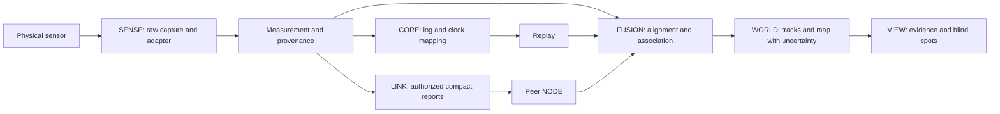

# System architecture

[Hub](../README.md) · **Names below define a proposed product architecture, not existing packages or shipped products.**

> **Edition 2 reconciliation:** Project intent follows the [canonical charter](north-star.md). Local code links below still target `77abdd0`; newer Alpha `95eae17` source/build/simulation status is recorded in the [separate review](alpha-95eae17-review.md), without a merge. Reported builds and 261 tests do not establish flashed or hardware-validated firmware.

| Layer | Responsibility | Baseline implementation / gap |
|---|---|---|
| **SPECTER-X** | Initial multispectral wearable / skeletal-perception / AR interface to the ecosystem | Existing research repository and HUD; complete wearable/AR integration unvalidated |
| **SPECTER-OS** | Unified device/software foundation: firmware, drivers, protocols, scheduling, health, calibration and communication | Architectural ambition spanning CORE/SENSE/LINK and supporting services; no independent OS/kernel claimed |
| **SPECTER-CORE** | Runtime, configuration, device registry, lifecycle, clock service, logging and replay orchestration | `specter/app.py`, events and hardware helpers; no complete independent CORE service |
| **SPECTER-NODE** | A physical compute/sensor unit with identity, power and health | Local host plus peripherals; multi-node operation primarily simulated |
| **SPECTER-SENSE** | Device adapters producing raw observations and calibrated measurements | `specter/sensors/`; mixed real paths, parsers and stubs |
| **SPECTER-LINK** | Discovery, transport, identity, freshness and access control | `specter/net/`; HMAC UDP prototype; confidentiality and durable replay protection missing |
| **SPECTER-FUSION** | Time alignment, transforms, association and state estimation | Measurement/frame helpers, team association, EKF; real multimodal rig unvalidated |
| **SPECTER-WORLD** | Versioned environment model, occupancy, tracks and history | Proposed coherent layer; do not equate the current track list with a complete world model |
| **SPECTER-VIEW** | HUD, maps, diagnostic plots, replay and evidence inspection | `specter/hud/` and CSI/DAQ tools; new interfaces remain proposals |

## Product families and technical layers

The [charter](north-star.md) defines product/program identities. CORE, NODE, SENSE, LINK, FUSION and VIEW remain implementation boundaries, not replacement names for that vision. WORLD spans persistent spatial semantics, uncertainty and history. AIR/GROUND/ORBIT are future platform/data/comms extensions; BIO is the experimental physiology/quantum laboratory track. These names do not claim shipped subsystems or require a package rename.

## Data path and trust boundaries

Every NODE owns its hardware interfaces and local monotonic clock. SENSE cannot label a synthetic sample as real. FUSION cannot promote a weak presence feature into a localized skeleton without a demonstrated observation model. WORLD retains conflicting hypotheses when evidence cannot resolve association. VIEW exposes modality, freshness, validity and provenance rather than smoothing away a disconnect.

Raw video stays local by default; the existing team design sends compact tracks. This reduces bandwidth but does not make positions or skeletons nonsensitive. Authorization and encryption remain required design work for sensitive multi-unit research.

## Model boundaries

- **Raw observation:** bytes, frames, ADC counts or complex CSI plus device metadata.
- **Measurement:** a typed value in stated units/frame/time with provenance and calibration validity.
- **Feature:** derived quantity with parent observation IDs, window and preprocessing version.
- **Detection:** a task-specific inference; include threshold, quality state and validation domain.
- **Track:** an evolving hypothesis with state covariance, age and contributing evidence.
- **World entity:** a persistence decision across tracks and maps; identity is not inferred merely because a track persisted.

## Deployment pattern

Start with one host and one reader per physical stream. Keep radio capture decoupled from rendering and analysis so UI delays cannot starve acquisition. Add Pi or other edge compute only after hardware receipts and latency/power measurement. Later NODE variants may share protocol and logs without sharing every processor, OS or firmware.

Device heartbeat, host receipt health and team heartbeat remain separate. A live host cannot prove a silent peripheral is functioning. A live peripheral cannot prove its sensor is calibrated. A healthy network cannot prove peer coordinates share the same anchor.

## Design decisions for this edition

1. Retain existing Python package layout; names above are conceptual ownership boundaries.
2. Preserve `Measurement` as the baseline integration point; evolve schemas deliberately.
3. Prefer sparse peer reports over automatic raw-stream forwarding; retain local evidence references.
4. Make WORLD a consumer of validated observations, with explicit unknown space and age.
5. Keep experimental sensing behind capability flags and distinct evidence labels.
6. Use hardware abstraction to support a family of components without promising identical capabilities at every price point.

Interface details and compatibility gaps are specified in the [ICD](interfaces.md).
